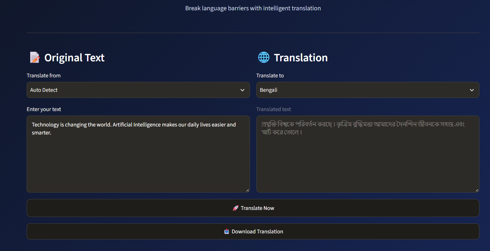
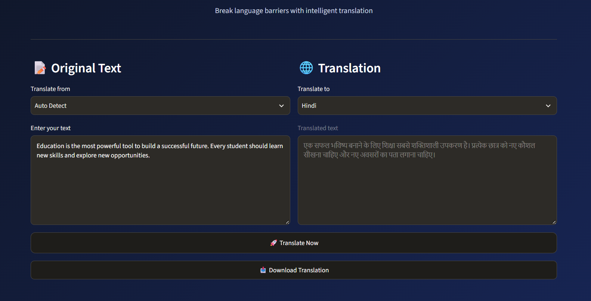
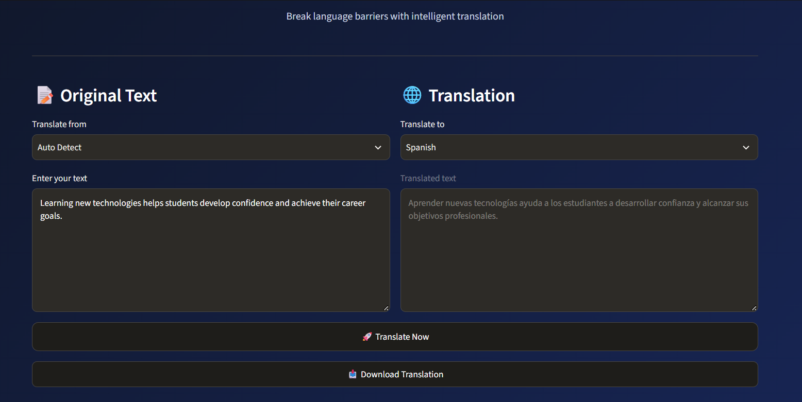

# 🌍 AI Language Translator | Multilingual Translation App

<p align="center">

  **Breaking Language Barriers with Technology**

  A user-friendly multilingual translation application built with Python and Streamlit. Translate text between multiple languages with automatic language detection, translation history, and downloadable results.

</p>

---

## 🚀 Project Overview

The **AI Language Translator** is a Python-based web application designed to make communication across different languages easier and faster.

It uses the MyMemory Translation service to translate text and the Langdetect library to identify the input language automatically. With a clean and interactive Streamlit interface, users can translate text, view previous translations, and download translated results.

## ✨ Key Features

- 🌐 **Multilingual Translation:** Translate text across multiple supported languages.
- 🔍 **Automatic Language Detection:** Detects the source language automatically.
- 🔄 **Flexible Language Selection:** Choose source and target languages.
- 💬 **Translation History:** Keeps track of previous translations during the session.
- 📥 **Download Translations:** Download translated text for future use.
- 🎨 **Interactive Interface:** Clean and easy-to-use Streamlit dashboard.
- ⚡ **Fast Translation:** Uses an online translation service to process text.

## 🖥️ Project Screenshots

### 🇧🇩 English to Bengali



### 🇮🇳 English to Hindi



### 🇪🇸 English to Spanish



## 🛠️ Technologies Used

| Technology | Purpose |
|---|---|
| Python | Core programming language |
| Streamlit | Web application interface |
| MyMemory Translator | Online text translation |
| Deep Translator | Translation library |
| Langdetect | Automatic language detection |

## 🌎 Supported Languages

The application includes options such as:

- English
- Bengali
- Hindi
- Spanish
- French
- German
- Japanese
- Chinese
- Arabic
- Portuguese
- Russian
- Italian
- Korean
- Tamil
- Telugu
- Marathi
- Urdu

*Translation availability may depend on the online translation service.*

## ⚙️ Installation and Setup

Follow these steps to run the project locally.

**1. Clone the repository**

```bash
git clone https://github.com/YOUR-USERNAME/CodeAlpha_AI_Language_Translator.git
```

**2. Open the project folder**

```bash
cd CodeAlpha_AI_Language_Translator
```

**3. Install the required libraries**

```bash
pip install -r requirements.txt
```

**4. Run the application**

```bash
python -m streamlit run app.py
```

**5. Open the application**

Open the local URL displayed in your terminal, usually:

```text
http://localhost:8501
```

## 📁 Project Structure

```text
CodeAlpha_Language_Translator/
│
├── app.py
├── requirements.txt
├── README.md
│
└── screenshots/
    ├── bengali_translation.png
    ├── hindi_translation.png
    └── spanish_translation.png
```

## 💡 How It Works

1. Enter the text you want to translate.
2. Select the source and target languages.
3. Use automatic language detection when available.
4. Click the Translate button.
5. View the translated result.
6. Download the translation or review your history.

## 🎯 Project Objective

The main objective of this project is to develop an accessible multilingual translation application that helps users communicate across language barriers through a simple and interactive interface.

## 👨‍💻 Developed By

**Subham Acharjya**

AI & Machine Learning Enthusiast | B.Tech CSE (AI)

Developed as part of the **CodeAlpha AI Internship**.

## ⭐ Support

If you find this project interesting, consider giving this repository a ⭐ on GitHub!

---

<p align="center">

  **Built with ❤️ using Python and Streamlit**

</p>
